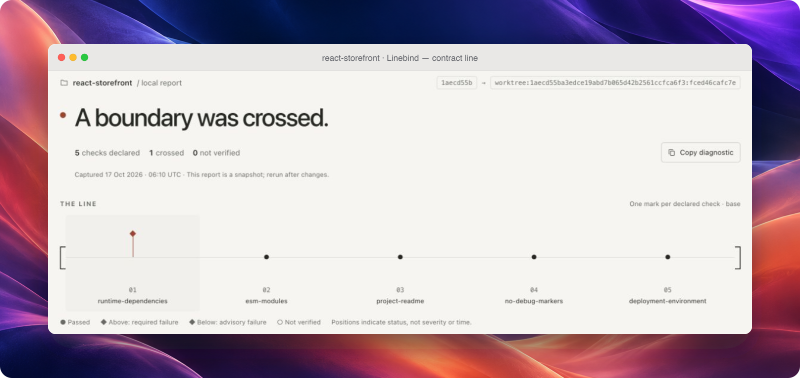

<p align="center">
  <picture>
    <source media="(prefers-color-scheme: dark)" srcset="docs/assets/wordmark-dark.svg">
    
  </picture>
</p>

<p align="center"><strong>Keep project decisions from drifting.</strong></p>
<p align="center">A free, open-source CLI for explicit repository rules.<br>Check a change against its trusted base. See what crossed the line.</p>

<p align="center">
  <a href="https://github.com/mchl-schrdng/linebind/actions/workflows/ci.yml?query=branch%3Amain+event%3Apush"></a>
  <a href="https://github.com/mchl-schrdng/linebind/actions/workflows/codeql.yml"></a>
  <a href="https://github.com/mchl-schrdng/linebind/actions/workflows/contract.yml?query=event%3Apull_request"></a>
  <a href="https://github.com/mchl-schrdng/linebind/actions/workflows/release.yml?query=event%3Apush"></a>
</p>

<p align="center">
  <a href="https://github.com/mchl-schrdng/linebind/releases/latest"></a>
  <a href="go.mod"></a>
  <a href="LICENSE"></a>
  <a href="docs/installation.md"></a>
</p>

<p align="center">
  <a href="#get-started">Get started</a> ·
  <a href="#what-can-a-contract-check">What it checks</a> ·
  <a href="#tested-in-ci">CI</a> ·
  <a href="#with-your-coding-agent">Coding agents</a> ·
  <a href="docs/configuration.md">Configuration</a>
</p>

A PR can pass its tests and still add an unwanted dependency, change a deployment
setting or ship a migration without its notes. Linebind checks those explicit
project decisions against a YAML contract stored in Git.

**`check` reads the contract from the selected trusted base.** A PR cannot make
itself pass by weakening that contract. Proposed rule changes remain visible
for review; `preview` lets you evaluate them before adoption.

The CLI is **free and MIT-licensed**. Native checks need only Linebind and Git:
no account, dependency installation or model API. Results are available in the
terminal, JSON and an offline HTML report. [Linebind Cloud](https://linebind-cloud.vercel.app/)
adds a GitHub App and shared PR reports, currently free during early access.
It is optional; local checks and CI work without it.

<p align="center">
  
</p>

## Get started

Download the [latest release](https://github.com/mchl-schrdng/linebind/releases/latest)
for macOS, Linux or Windows. Verify the archive, extract it and put `linebind`
on your `PATH`. [Installation and checksums](docs/installation.md)

In an existing Git repository with at least one commit, a `README.md`, and no
contract yet, run these commands in a POSIX shell:

```sh
BASE_SHA=$(git rev-parse --verify 'HEAD^{commit}')
linebind init
linebind validate
linebind preview --base "$BASE_SHA" --html .linebind/report.html
```

Open `.linebind/report.html` in your browser. The starter checks only that
`README.md` exists. Edit `.linebind.yml` to describe decisions your project
actually needs, then validate and preview again.

Here, the saved commit is a comparison baseline. Preview evaluates the draft;
your repository's review and merge process adopts it.

**[Try the disposable demo](docs/try-it.md)** to introduce an undeclared
dependency, fix it, then propose a deliberate contract change. Only Git and
Linebind are required.

## A frontend change in practice

A feature adds jQuery to `package.json`. The project has agreed to review new
runtime packages, so its contract identifies the dependency and explains what
to do next. Here is the dependency rule from the report as a complete contract:

```yaml
version: 1
name: Frontend decisions
rules:
  - id: runtime-dependencies
    kind: dependencies
    reason: Keep runtime packages deliberate and explain each new dependency.
    scope: [package.json]
    dependencies:
      format: npm
      sections: [dependencies]
      allow: [react, react-dom]
    remediation: Remove the accidental package or propose a contract change.
```

The rule checks declared package names. It does not judge versions,
vulnerabilities or application behavior. Its allowlist is a project decision,
not a universal frontend recommendation.

Remove an accidental dependency and rerun the check. If the project deliberately
needs a new package, propose the dependency and contract change together. The
report keeps that policy change visible for review.

<p align="center">
  <a href="docs/assets/report-v0.4.0/mac/line-mac.png">
    
  </a>
</p>

<p align="center"><sub>Four checks pass. One dependency crosses the boundary. Real v0.4.0 evidence in a Mac-style presentation. <a href="docs/assets/README.md">Capture notes</a></sub></p>

In the HTML report, each mark represents a declared check. Select a mark to
read its reason, evaluated rule, evidence and next step. Required failures rise
above the line; advisory failures sit below it. Hollow marks mean verification
is incomplete.

## Keep related changes together

New in v0.5.0: a `co-change` rule can require migration notes when SQL changes.
Add this rule to your contract:

```yaml
- id: migration-guide
  kind: co-change
  reason: Ship migration instructions with schema changes.
  scope: [migrations/**]
  co-change:
    require: [docs/migrations.md]
```

Changing a migration without adding or updating the guide crosses the check.
Deleting the guide does not satisfy it. This verifies an accompanying edit,
not its quality; a whitespace edit counts. [Runnable example](examples/co-change/README.md)

## What can a contract check?

| Rule | Example decision | What it checks |
| --- | --- | --- |
| [`require-files`](docs/configuration.md#require-files) | Keep a license and architecture document | Required paths and glob matches |
| [`forbid-text`](docs/configuration.md#forbid-text) | Keep debug markers out of shipped source | Go/RE2 patterns in selected text |
| [`dependencies`](docs/configuration.md#dependency-names) | Review new runtime packages | Declared names in npm, Go, Python and Cargo manifests |
| [`document`](docs/configuration.md#json-and-yaml-values) | Preserve an API operation or deployment setting | Selected JSON/YAML values |
| [`co-change`](docs/configuration.md#co-change) | Ship notes with a migration | Accompanying content edits between base and candidate |
| [`command`](docs/configuration.md#project-commands) | Run an existing architectural or policy verifier | Exit codes, dependency-cruiser or Conftest results |

Each rule records a reason, its inputs and optional remediation. Use
`required: false` for an advisory rule. Use `compare: new` on supported checks
to distinguish new, existing and resolved findings while blocking new debt;
`strict` is the default. [Configuration reference](docs/configuration.md)

Native checks inspect captured files without executing project code. They do
not infer architecture, resolve complete dependency graphs or establish runtime
correctness. External commands require installed tools and `--allow-exec`;
their disposable execution copy **is not a sandbox**.

## Check adopted rules. Preview proposed changes.

| | `check` | `preview` |
| --- | --- | --- |
| Contract source | Selected base | Candidate |
| Purpose | Enforce adopted policy | Validate proposed policy |
| Policy changes alone | Exit `1`; review required | Visible in the report; can pass |
| Adoption | Depends on the base your repository trusts | Never established by preview |

Once a contract has been adopted, set `BASE_SHA` to its reviewed base commit's
full SHA and keep it fixed while evaluating your change:

```sh
linebind check --base "$BASE_SHA" --html .linebind/check.html
linebind preview --base "$BASE_SHA" --html .linebind/preview.html
```

Both commands inspect the working tree by default. Add `--head "$HEAD_SHA"`
to evaluate a committed candidate. Editing the candidate allowlist does not
change the rules used by `check`.

A proposed allowlist can pass `preview` while `check` against the original base
still reports the policy change. Review and merge adopt the proposal; preview
never approves it. [Example report](docs/assets/report-v0.4.0/mac/preview-mac.png) ·
[Trust model](docs/trust-model.md)

## Tested in CI

[CI](.github/workflows/ci.yml) runs Go tests and vet on Linux, macOS and
Windows, verifies six release archives, exercises installed binaries and
examples, and checks real tool adapters and report interactions.
[Tagged releases](.github/workflows/release.yml) run that suite before publishing.
[CodeQL](.github/workflows/codeql.yml) adds static analysis; a successful run
is not a guarantee that no security issue exists.

This repository's [contract check](.github/workflows/contract.yml) uses `preview`
with explicit PR base/head SHAs and a checksum-pinned released verifier. Valid
policy edits can pass proposal validation; required violations and incomplete
checks fail. The repository's required CI must pass before merging.

The setup Action supports Linux x64. Its default verifier and this repository's
contract gate are independently pinned to **v0.5.0**; they do not automatically
track the latest release. Select a version and matching checksum explicitly
when adopting newer rules.

[Set up the GitHub Action](docs/ci.md#install-with-the-setup-action) ·
[Choose the CI mode and required checks](docs/ci.md) ·
[Read this repository's contract](docs/self-contract.md)

## With your coding agent

```sh
linebind setup --agent all
```

Install the bundled skill for **Codex, Claude Code and Antigravity**, or select
one with `--agent codex`, `claude` or `antigravity`. Add `--dry-run` to inspect
the changes first.

The skill helps your agent prepare a contract from explicit project decisions,
check changes and explain policy proposals. Installation is offline, preserves
existing instructions, and does not create or approve a contract.

[Agent setup and workflow](docs/agents.md)

## Read the result correctly

| Status | Meaning |
| --- | --- |
| `passed` | The declared check passed under its comparison mode |
| `crossed` | A violation or configured failure outcome was found |
| `unverified` | A complete result could not be established |

Required results control the exit: **`0`** passes, **`1`** reports a required
violation, and **`2`** reports incomplete required verification or an invalid
operation. `check` also returns `1` for policy changes; `preview` does not fail
on policy changes alone. Advisory findings remain visible without failing the
command. If a required violation and incomplete verification coexist, the exit
is `1`.

A passing result covers the declared checks and captured inputs. It does not
certify the whole repository. [Report guide](docs/report.md) ·
[Trust model and limits](docs/trust-model.md)

## Documentation and contributing

[Installation](docs/installation.md) · [Walkthrough](docs/try-it.md) ·
[Configuration](docs/configuration.md) · [Examples](docs/examples.md) ·
[CI integration](docs/ci.md) · [Validation](docs/validation.md) ·
[Contributing](CONTRIBUTING.md)

The CLI is written in Go. Run `go test ./...` and `go vet ./...` for local
checks; see the contributing guide for packaging and release validation.

Reading this from a downloaded archive? The
[online README](https://github.com/mchl-schrdng/linebind#readme) includes the
linked guides and images.

---

<p align="center">
  Made by <a href="https://github.com/mchl-schrdng">mchl-schrdng</a> ·
  <a href="LICENSE">MIT</a> ·
  <a href="SECURITY.md">Security</a>
</p>
