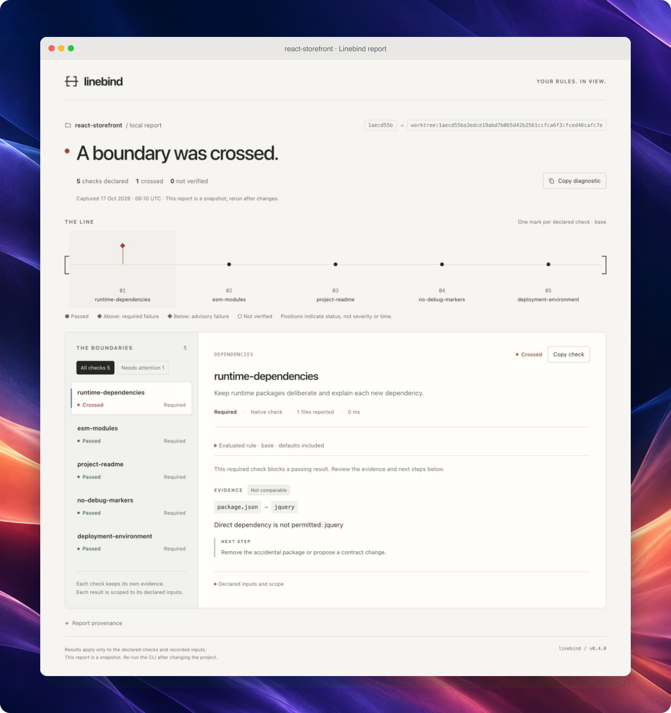
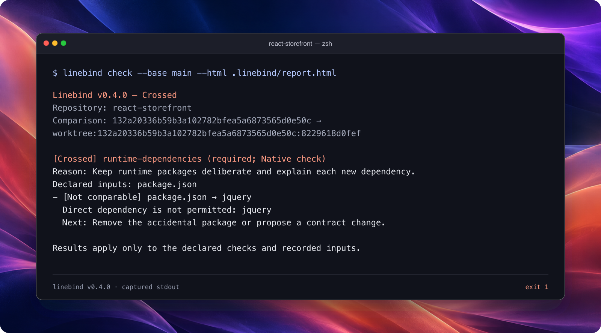
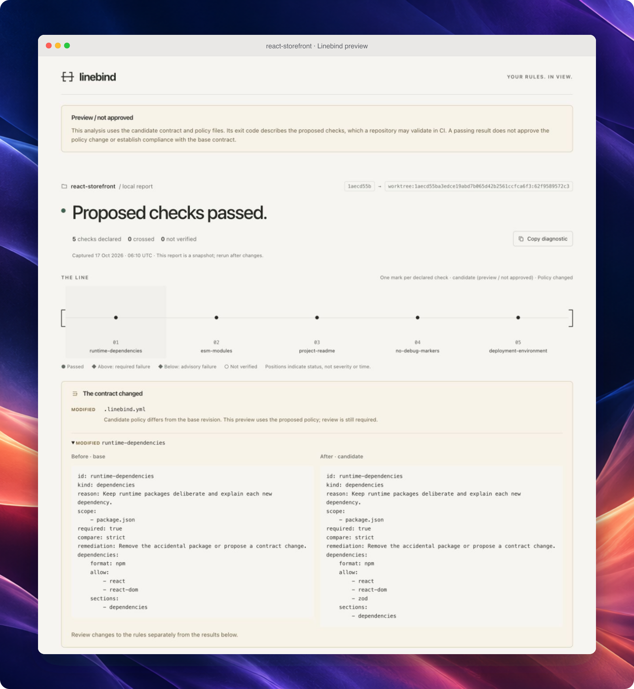

<p align="center">
  <picture>
    <source media="(prefers-color-scheme: dark)" srcset="docs/assets/wordmark-dark.svg">
    
  </picture>
</p>

<p align="center"><strong>Versioned repository rules. Evidence for every change.</strong></p>
<p align="center">Declare the decisions your project relies on.<br>Check changes locally and in CI. Read the rule, result and evidence together.</p>

<p align="center">
  <a href="https://github.com/mchl-schrdng/linebind/actions/workflows/ci.yml?query=branch%3Amain+event%3Apush">
    
  </a>
  <a href="https://github.com/mchl-schrdng/linebind/actions/workflows/codeql.yml">
    
  </a>
  <a href="https://github.com/mchl-schrdng/linebind/actions/workflows/contract.yml?query=event%3Apull_request">
    
  </a>
  <a href="https://github.com/mchl-schrdng/linebind/actions/workflows/release.yml?query=event%3Apush">
    
  </a>
</p>

<p align="center">
  <a href="#get-started">Get started</a> ·
  <a href="#what-can-a-contract-check">What it checks</a> ·
  <a href="#tested-in-ci">CI</a> ·
  <a href="#with-your-coding-agent">Coding agents</a> ·
  <a href="docs/configuration.md">Configuration</a>
</p>

Linebind checks files, dependency declarations and configuration against a YAML
contract. One executable and Git are enough for native checks: no account,
package installation or model API. Results stay readable in the terminal,
JSON and a self-contained, offline HTML report.

<p align="center">
  <a href="docs/assets/report-v0.4.0/mac/line-mac.png">
    
  </a>
</p>

<p align="center"><sub>Four checks pass. One dependency crosses the boundary. Real v0.4.0 evidence in a Mac-style presentation. <a href="docs/assets/README.md">Capture notes</a></sub></p>

In the HTML report, each mark represents a declared check. Select a mark to
read its reason, evaluated rule, evidence and next step. Required failures rise
above the line; advisory failures sit below it. Hollow marks mean verification
is incomplete.

<p align="center">
  <a href="docs/assets/report-v0.4.0/mac/report-mac.png">
    
  </a>
</p>

<p align="center"><sub>The complete interface: declared checks, evidence and provenance in one offline report.</sub></p>

## Get started

Download the [latest release](https://github.com/mchl-schrdng/linebind/releases/latest)
for macOS, Linux or Windows. Verify the archive, extract it and put `linebind`
on your `PATH`. [Installation and checksums](docs/installation.md)

In an existing Git repository with at least one commit, a `README.md`, and no
contract yet, run these commands in a POSIX shell:

```sh
BASE_SHA=$(git rev-parse --verify 'HEAD^{commit}')
linebind init
linebind validate
linebind preview --base "$BASE_SHA" --html .linebind/report.html
```

Open `.linebind/report.html` in your browser. The starter checks only that
`README.md` exists. Edit `.linebind.yml` to describe decisions your project
actually needs, then validate and preview again.

Here, the saved commit is a comparison baseline. Preview evaluates the draft;
your repository's review and merge process adopts it.

**[Try the disposable demo](docs/try-it.md)** to introduce an undeclared
dependency, fix it, then propose a deliberate contract change. Only Git and
Linebind are required.

## A frontend change in practice

A feature adds jQuery to `package.json`. The project has agreed to review new
runtime packages, so its contract identifies the dependency and explains what
to do next. Here is the dependency rule from the report as a complete contract:

```yaml
version: 1
name: Frontend decisions
rules:
  - id: runtime-dependencies
    kind: dependencies
    reason: Keep runtime packages deliberate and explain each new dependency.
    scope: [package.json]
    dependencies:
      format: npm
      sections: [dependencies]
      allow: [react, react-dom]
    remediation: Remove the accidental package or propose a contract change.
```

The rule checks declared package names. It does not judge versions,
vulnerabilities or application behavior. Its allowlist is a project decision,
not a universal frontend recommendation.

Remove an accidental dependency and rerun the check. If the project deliberately
needs a new package, propose the dependency and contract change together. The
report keeps that policy change visible for review.

<p align="center">
  <a href="docs/assets/report-v0.4.0/mac/terminal-mac.png">
    
  </a>
</p>

<p align="center"><sub>The same rule, straight from the CLI. Captured stdout from the one-rule README fixture; exit <code>1</code>. <a href="docs/assets/README.md">Output and reproduction</a></sub></p>

## What can a contract check?

| Rule | Example decision | What it checks |
| --- | --- | --- |
| [`require-files`](docs/configuration.md#require-files) | Keep a license and architecture document | Required paths and glob matches |
| [`forbid-text`](docs/configuration.md#forbid-text) | Keep debug markers out of shipped source | Go/RE2 patterns in selected text |
| [`dependencies`](docs/configuration.md#dependency-names) | Review new runtime packages | Declared names in npm, Go, Python and Cargo manifests |
| [`document`](docs/configuration.md#json-and-yaml-values) | Preserve an API operation or deployment setting | Selected JSON/YAML values |
| [`command`](docs/configuration.md#project-commands) | Run an existing architectural or policy verifier | Exit codes, dependency-cruiser or Conftest results |

Each rule records a reason, its inputs and optional remediation. Use
`required: false` for an advisory rule. Use `compare: new` on supported checks
to distinguish new, existing and resolved findings while blocking new debt;
`strict` is the default. [Configuration reference](docs/configuration.md)

Native checks inspect captured files without executing project code. They do
not infer architecture, resolve complete dependency graphs or establish runtime
correctness. External commands require installed tools and `--allow-exec`;
their disposable execution copy **is not a sandbox**.

## Check adopted rules. Preview proposed changes.

| | `check` | `preview` |
| --- | --- | --- |
| Contract source | Selected base | Candidate |
| Purpose | Enforce adopted policy | Validate proposed policy |
| Policy changes alone | Exit `1`; review required | Visible in the report; can pass |
| Adoption | Depends on the base your repository trusts | Never established by preview |

Once a contract has been adopted, set `BASE_SHA` to its reviewed base commit's
full SHA and keep it fixed while evaluating your change:

```sh
linebind check --base "$BASE_SHA" --html .linebind/check.html
linebind preview --base "$BASE_SHA" --html .linebind/preview.html
```

Both commands inspect the working tree by default. Add `--head "$HEAD_SHA"`
to evaluate a committed candidate. Editing the candidate allowlist does not
change the rules used by `check`.

<p align="center">
  <a href="docs/assets/report-v0.4.0/mac/preview-mac.png">
    
  </a>
</p>

<p align="center"><sub>A deliberate allowlist change in the same fixture. Before/after definitions stay visible; <strong>Preview / not approved</strong> identifies the proposed policy. <a href="docs/assets/README.md">Capture notes and evidence</a></sub></p>

The preview above passes. A separate `check` against the original base still
returns `1`. Merging after the required checks and policy review adopts the
proposal in this repository. [Trust model](docs/trust-model.md)

## Tested in CI

The badges link to **`main` CI**, **CodeQL analysis**, the latest
**pull-request contract run** and **tagged releases**. Each opens its workflow
history; the PR contract badge is not an aggregate of every open PR.

| Workflow | What it verifies |
| --- | --- |
| [CI](.github/workflows/ci.yml) | Go tests and vet on Linux, macOS and Windows; six release archives and checksums; installed and extracted binaries; runnable examples; minimum Go version; real external-tool adapters; report interactions; setup Action installation. |
| [CodeQL](.github/workflows/codeql.yml) | Static security analysis of Go packages built on Linux, with findings published to GitHub code scanning. Runs on PRs and pushes to `main`. |
| [Repository contract](.github/workflows/contract.yml) | Each PR's proposed contract against explicit base/head commits, using a checksum-pinned published verifier. JSON and offline HTML evidence are retained, including on failure. |
| [Release](.github/workflows/release.yml) | Runs the CI suite for a version tag, then publishes the tested archives and checksums. |

The contract workflow uses `preview`: valid policy edits can pass proposal
validation. Required violations, incomplete required checks and invalid
contracts fail the job. `main` requires its configured test and contract checks
to pass before merging.

A passing CodeQL badge means the analysis completed successfully; it does not
mean the repository has no security findings.

The setup Action supports Linux x64. Its default verifier and this repository's
contract gate are independently pinned to **v0.3.0**; they do not automatically
track the latest release. Select a version and matching checksum explicitly
when adopting newer rules.

[Set up the GitHub Action](docs/ci.md#install-with-the-setup-action) ·
[Choose the CI mode and required checks](docs/ci.md) ·
[Read this repository's contract](docs/self-contract.md)

## With your coding agent

```sh
linebind setup --agent all
```

Install the bundled skill for **Codex, Claude Code and Antigravity**, or select
one with `--agent codex`, `claude` or `antigravity`. Add `--dry-run` to inspect
the changes first.

The skill helps your agent prepare a contract from explicit project decisions,
check changes and explain policy proposals. Installation is offline, preserves
existing instructions, and does not create or approve a contract.

[Agent setup and workflow](docs/agents.md)

## Read the result correctly

| Status | Meaning |
| --- | --- |
| `passed` | The declared check passed under its comparison mode |
| `crossed` | A violation or configured failure outcome was found |
| `unverified` | A complete result could not be established |

Required results control the exit: **`0`** passes, **`1`** reports a required
violation, and **`2`** reports incomplete required verification or an invalid
operation. `check` also returns `1` for policy changes; `preview` does not fail
on policy changes alone. Advisory findings remain visible without failing the
command. If a required violation and incomplete verification coexist, the exit
is `1`.

A passing result covers the declared checks and captured inputs. It does not
certify the whole repository. [Report guide](docs/report.md) ·
[Trust model and limits](docs/trust-model.md)

## Documentation and contributing

[Installation](docs/installation.md) · [Walkthrough](docs/try-it.md) ·
[Configuration](docs/configuration.md) · [Examples](docs/examples.md) ·
[CI integration](docs/ci.md) · [Validation](docs/validation.md) ·
[Contributing](CONTRIBUTING.md)

The CLI is written in Go. Run `go test ./...` and `go vet ./...` for local
checks; see the contributing guide for packaging and release validation.

Reading this from a downloaded archive? The
[online README](https://github.com/mchl-schrdng/linebind#readme) includes the
linked guides and images.

---

<p align="center">
  Made by <a href="https://github.com/mchl-schrdng">mchl-schrdng</a> ·
  <a href="LICENSE">MIT</a> ·
  <a href="SECURITY.md">Security</a>
</p>
