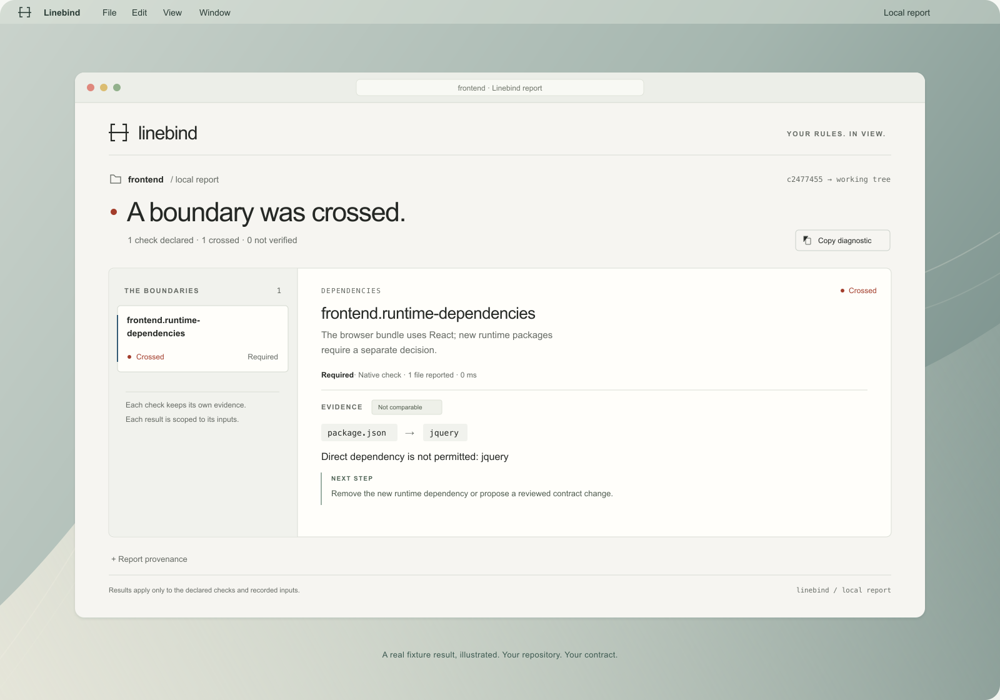
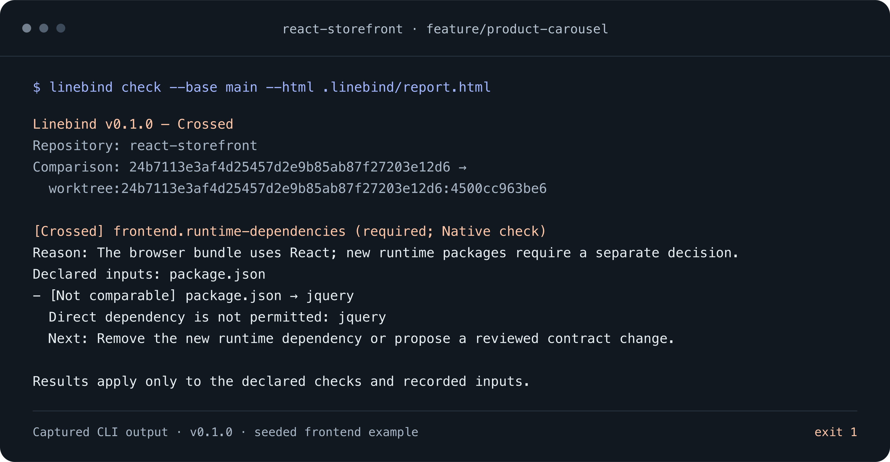

<p align="center">
  <picture>
    <source media="(prefers-color-scheme: dark)" srcset="docs/assets/wordmark-dark.svg">
    
  </picture>
</p>

<p align="center"><strong>Your repository. Your contract.</strong></p>
<p align="center">Keep the decisions that matter in a versioned contract.<br>Check changes locally, in CI, and in a readable, offline report.</p>

<p align="center">
  <a href="#what-can-a-contract-check">What it checks</a> ·
  <a href="#get-started">Get started</a> ·
  <a href="#a-frontend-change-in-practice">A real workflow</a> ·
  <a href="#with-your-coding-agent">Coding agents</a> ·
  <a href="docs/configuration.md">Write a contract</a> ·
  <a href="docs/examples.md">Try the examples</a>
</p>

<br>



<p align="center"><sub>A real example result, illustrated on a desktop. <a href="docs/assets/README.md">Artwork and evidence</a></sub></p>

## Keep the reasoning with the rule.

A new dependency. A missing API operation. A deployment setting changed in a
routine refactor. Whether a person or an agent made the change, the question is
the same: does it still respect the decisions your project relies on?

Linebind checks a candidate commit or working tree against a versioned contract.
Use the base contract to enforce adopted decisions, or the candidate contract
to validate a proposed evolution. Each rule has a reason, a scope and a verification
method. The result keeps the evidence, the comparison and the limits together.

- **Make the boundary explicit.** Commit a `.linebind.yml` alongside your code.
  Start with one important decision and add checks when they earn their place.
- **See what changed.** Compare findings with the base to distinguish new,
  existing and resolved issues. Changes to the contract itself stay visible.
- **Understand the result.** Read a compact terminal diagnostic, consume JSON,
  or open a self-contained HTML report. A check that could not run has its own
  status.

Native checks inspect files, text, dependency manifests and JSON/YAML documents.
Opt-in commands connect specialist tools. The same contract workflow works
across frontend, backend, data and infrastructure repositories; the coverage
comes from the checks you actually declare.

## What can a contract check?

**Linebind has five rule kinds: four native checks and one way to connect external
tools.** Native checks inspect captured files without installing dependencies
or executing project code.

| Rule kind | Example decision | What the check establishes |
| --- | --- | --- |
| [`require-files`](docs/configuration.md#require-files) | Keep `README.md`, `LICENSE` and `docs/architecture.md`. | Each required path or glob matches at least one file. Presence does not establish content quality. |
| [`forbid-text`](docs/configuration.md#forbid-text) | Keep the marker `DEBUG_ONLY` out of `src/`. | A Go/RE2 regular expression does not match the selected text. Comments and strings are included; this is not language or import analysis. |
| [`dependencies`](docs/configuration.md#dependency-names) | Permit only React and React DOM as runtime dependencies, or forbid jQuery. | Declared names satisfy an allowlist or denylist in `package.json` or `go.mod`. This does not resolve transitive dependencies, enforce version ranges or audit vulnerabilities. |
| [`document`](docs/configuration.md#json-and-yaml-values) | Preserve `type: module`, a declared API operation, or `runAsNonRoot: true`. | Selected JSON/YAML values satisfy an explicit condition. This checks declarations, not a running service, deployment or dataset. |
| [`command`](docs/configuration.md#project-commands) | Enforce module boundaries or require a SQL transformation to produce unique IDs. | An installed tool or supplied script reports the configured outcome. Its coverage comes from that verifier and its policy. |

For **dependency rules**, choose exactly one of `allow` or `deny`. npm rules
can select `dependencies`, `devDependencies`, `peerDependencies` and
`optionalDependencies`; omitting `sections` checks all four. Go rules inspect
direct `require` entries and their replacements, with the limitations in the
[reference](docs/configuration.md#dependency-names).

For **document rules**, choose one condition per rule:

- `document.required: true`: the selected value must exist and be non-null.
- `document.equals`: it must equal the specified scalar or null value.
- `document.forbidden-values`: an existing value must not equal a listed value;
  this condition alone allows the value to be absent.

Selectors can traverse objects and arrays, including `*` for their children.
These are focused assertions, not complete JSON Schema or OpenAPI validation.

For **command rules**, `command.format` selects one of three result formats:

- `exit`: interpret the configured success/failure exit codes of a script or tool.
- `dependency-cruiser`: retain structured findings from declared module/import rules.
- `conftest`: retain structured findings from the configured Conftest policies.

Commands require `--allow-exec`, tools already installed, and a suitable execution
environment. They run with host permissions; the disposable copy is not a sandbox.
Checks for visual regressions, accessibility, performance or actual data rows
need an appropriate external verifier and explicit criteria.

Each rule also records **where** it applies (`scope`), **why** it exists
(`reason`) and an optional next action (`remediation`). `required: false` makes
it advisory. `compare: strict` checks all current violations; `compare: new`
blocks additional findings while preserving existing debt in the report.
The `new` mode applies to native and structured command checks, not `format: exit`.

Changes to the effective contract or declared policy files are also reported
and require review. Missing or incomplete analysis remains `unverified`.
The [configuration reference](docs/configuration.md) contains the complete YAML
syntax and examples for each kind.

## Get started

For a hands-on first run, follow the [disposable frontend demo](docs/try-it.md).

Download a standalone binary from the [releases](https://github.com/mchl-schrdng/linebind/releases)
for macOS, Linux or Windows, on Intel/AMD or ARM64. Extract the archive and put
`linebind` (`linebind.exe` on Windows) on your `PATH`.
See [installation](docs/installation.md) for archive names and checksum checks.

Linebind requires Git. The distributed binary runs without Go. For a source build:

<details>
<summary>Build this checkout with Go 1.26 or newer</summary>

```sh
git clone https://github.com/mchl-schrdng/linebind.git
cd linebind
go build -o ./bin/linebind ./cmd/linebind
./bin/linebind --version
```

Add the binary's directory to your `PATH`, or use its full path. On Windows,
build to `./bin/linebind.exe`.

</details>

Inside the Git repository you want to check:

```sh
linebind init
linebind validate
```

`init` creates a small starter contract and adds `/.linebind/` to `.gitignore`.
Edit the rules to describe your project, validate them, then review and commit
the contract. The base used below must contain that reviewed contract.

```sh
linebind check --base HEAD --html .linebind/report.html
```

This checks the current working tree against the contract in `HEAD`. Open
`.linebind/report.html` in your browser when you want the visual report; Linebind
does not start a server or open a browser automatically.

For a commit comparison and a machine-readable result:

```sh
linebind check --base main --head HEAD --format json --output .linebind/report.json
linebind report .linebind/report.json --output .linebind/report.html
```

Both revisions must already be available locally. Pick the base deliberately:
Linebind uses the revision you provide, rather than deciding which change your
team has approved.

## A frontend change in practice

You ask an agent to add a product carousel to a React storefront. It adds jQuery
to implement the feature. The team's decision was to review every new runtime
dependency, so the approved contract on `main` contains:

```yaml
version: 1
name: Frontend runtime dependencies

rules:
  - id: frontend.runtime-dependencies
    kind: dependencies
    reason: The browser bundle uses React; new runtime packages require a separate decision.
    scope: [package.json]
    dependencies:
      format: npm
      sections: [dependencies]
      allow: [react, react-dom]
    remediation: Remove the new runtime dependency or propose a reviewed contract change.
```

On the feature branch, `package.json` changes:

```diff
 "dependencies": {
   "react": "19.0.0",
-  "react-dom": "19.0.0"
+  "react-dom": "19.0.0",
+  "jquery": "3.7.1"
 }
```

With that reviewed contract already committed on `main`, check the feature
branch's working tree:

```sh
linebind check --base main --html .linebind/report.html
```



<p align="center"><sub>Actual v0.1.0 stdout, rendered as an image with line wrapping. <a href="docs/assets/frontend-cli.txt">Plain text</a> · <a href="docs/assets/frontend-cli.json">JSON evidence</a> · <a href="docs/assets/README.md#cli-output">Capture notes</a></sub></p>

The check returns `crossed` and exits with `1`. Its evidence identifies the
dependency, the reason for the rule and the next action. Adding jQuery to the
candidate's allowlist does not authorize it: this run still uses the contract
from `main` and reports the policy change separately.

The team can remove the dependency or review a contract change. In that second
case, `preview` validates the proposed contract, as our CI does; a valid policy
change alone can pass. This rule checks
declared dependency names in `dependencies`; it does not judge carousel behavior,
package versions or vulnerabilities. `Not comparable` in this output means the
rule uses the default strict mode; `compare: new` enables finding evolution.

**[Try the complete flow with only Git and the binary](docs/try-it.md)**:
introduce an accidental dependency, fix it, then deliberately evolve the contract.
No application packages are installed or executed. The [example runner](docs/examples.md)
adds malformed-input and missing-policy cases for contributors.

The [runnable examples](docs/examples.md) cover four different contexts:

| Context | A decision to preserve | What the native example checks |
| --- | --- | --- |
| Frontend | Keep runtime dependencies intentional | Names declared in an npm manifest |
| Backend | Keep an API operation and response declared | Selected values in an OpenAPI document |
| Data | Keep a field's declared nullability | A committed table-schema document |
| Infrastructure | Require a non-root container setting | A value in a Kubernetes manifest |

These are focused examples. They do not install packages, call a live API,
validate dataset rows or apply infrastructure.

## Protect an architectural boundary

A useful contract can preserve a small system design. In the
[architecture example](examples/dependency-cruiser), client code reaches domain
code through an API layer. Adding a helper inside an allowed layer passes;
reaching the domain through a shared relay fails. New unmapped modules and
dependency cycles fail too, within the declared JavaScript source tree.

The allowed layer map lives in dependency-cruiser's `rules.cjs`. Linebind binds
that policy to the contract, evaluates captured code and keeps the findings
with their reason and comparison. There is one executable map to maintain.
An intended architecture change can evolve that map in the same PR as code.

This graph recipe currently targets JavaScript without application packages.
It is **not a ready-made React, TypeScript or npm workspace integration**:
those projects still need a tested package-resolution and execution strategy.
Native npm manifest checks remain available independently of graph analysis.

The [mutation panels](docs/validation.md#stability-panels) test permitted
refactors, indirect violations and incomplete inputs against the actual
architecture, Pod and SQL recipes. They also keep known gaps visible: computed
imports, code outside the scope and business behavior need appropriate checks.
A passing contract establishes its declared checks, not whole-repository
correctness. No LLM interprets a rule's prose as an additional guarantee.

## With your coding agent

**Starting with v0.2.0, Linebind bundles a skill for Codex, Claude Code and
Antigravity.** See [installation](docs/installation.md) for the executable.
Install the CLI once in your environment, then run this in your project:

```sh
linebind setup --agent all
```

The executable installs its own skill and short repository instructions,
offline. Your project keeps its contract; it does not need a copy of Linebind's
Go repository. Use `--agent codex`, `claude` or `antigravity` to select one target,
or add `--dry-run` to inspect the installation first. Existing instructions are
preserved and conflicting files are never silently overwritten.

Start with your project decisions, perhaps defined with Ponytail. At the first
stable milestone, ask your agent to **prepare a Linebind contract from those
decisions and demonstrate what it catches**. During later development, the
skill guides ordinary repairs and deliberate proposals to evolve the contract.
It reuses your coding agent; Linebind needs no additional model API key.

Two commands keep that distinction explicit. `BASE_SHA` below is a full commit
ID selected by your project's review process, not a value Linebind invents:

```sh
linebind check --base "$BASE_SHA" --agent
linebind preview --base "$BASE_SHA" --agent --html .linebind/preview.html
```

`check` evaluates the base's approved policy. `preview` tries the candidate's
proposed policy and labels its evidence **not approved**. Our CI uses `preview`
to validate the proposed rules; the maintainer adopts them by merging the PR.
A contract edit alone does not fail that validation. Both commands
inspect the working tree by default and accept `--head` for a commit.

See [Working with coding agents](docs/agents.md) for first-contract setup,
the three agent integrations, policy evolution and current verification limits.

## In a pull request

Linebind checks its own repository with a committed [five-rule contract](.linebind.yml).
See [our contract and local workflow](docs/self-contract.md) for what it protects,
how its violations are tested and what remains outside its coverage.

The same check can run before a build or deployment. The complete
[GitHub Actions workflow](.github/workflows/contract.yml) pins the published
Linebind binary and its checksum, compares explicit base/head commits, and
validates the PR head under its proposed contract. JSON remains visible in the job log; JSON and HTML are
retained as downloadable artifacts even when the check fails.
The same artifact also retains an informational comparison with the adopted
contract, so relaxing a rule does not erase what the old rule would have caught.

Its core command uses explicit revisions from the pull-request event:

```sh
linebind preview --base "$BASE_SHA" --head "$HEAD_SHA" \
  --format json --html "$RUNNER_TEMP/linebind-report/report.html" \
  | tee "$RUNNER_TEMP/linebind-report/result.json"
```

The workflow uses Bash with `pipefail`, so an exit code of `1` or `2` fails the
job. A valid contract change can pass; a required violation, incomplete required
check or invalid contract cannot. Make **Linebind contract** and your tests
required in branch rules to block merges, or add `needs: contract` to a build
job in the same workflow. This repository requires all seven CI checks on
`main`, with no bypass and no mandatory second reviewer. Merging adopts the
proposed contract and can trigger your existing deployment pipeline.

See [CI integration](docs/ci.md) for the copyable workflow, first-contract setup,
policy-change review, artifact access and the workflow's trust boundary.

## How the check works

**No LLM, API key or model service is involved.** Linebind is a Go executable:

1. Git resolves the chosen base and captures the candidate files.
2. Linebind parses `.linebind.yml` from the base for `check`, or from the
   candidate for `preview`, and selects the declared inputs.
3. Native rules inspect those captured bytes. In the frontend example, it parses
   `package.json` and compares dependency names with the approved allowlist.
4. It records findings, policy changes and incomplete checks, then produces the
   exit code, terminal/JSON output and offline HTML report.

`reason` and `remediation` explain a rule to people and agents; the check is
defined by `kind`, `scope` and its parameters. Free-form prose is not interpreted
as an executable rule. With the same captured inputs and contract, native checks
produce the same findings; timestamps and execution durations can differ.

Native checking makes no model calls and uploads no source code. Optional
`command` rules require `--allow-exec` and invoke the external tool you configure;
that tool may have its own network or credential requirements.
A coding agent can invoke the same CLI and read its JSON or `--agent` diagnostics;
Linebind does not need a connection to the agent's model provider.

## The contract changes too.

`check` keeps using the base contract and reports policy edits as review-required.
`preview` evaluates the candidate contract and displays those edits without
failing merely because the rules changed. Both keep the comparison base fixed.

Our PR workflow uses `preview`: explain the new decision, review its effect on
coverage, and merge when the tests and proposed rules pass. The merge adopts
the contract. Linebind does not interpret a PR label or a local approval field
as authorization. The [trust model](docs/trust-model.md) describes the complete
boundary and the policy-change workflow.

For an existing repository, `compare: new` checks for additional findings while
keeping existing debt visible. It compares both snapshots under the same rule;
it does not mark the whole repository clean.

## Read the result correctly.

| Check status | Meaning |
| --- | --- |
| `passed` | The declared check passed under its comparison mode. |
| `crossed` | The check found a violation or a declared command returned a failure outcome. |
| `unverified` | The available inputs or execution could not establish a complete result. |

For `check`, required checks determine the command's exit code. Advisory findings remain in
the report, so a report can show a crossed or unverified advisory check while
the CLI exits successfully.

| Exit code | Meaning |
| --- | --- |
| `0` | Required checks passed and no effective policy change requires review. |
| `1` | A required check crossed its boundary, or the contract/policy files changed. |
| `2` | Verification is incomplete for a required check, or the command/input is invalid. |

When a required violation and an incomplete check coexist, the exit code is `1`;
the incomplete check and its diagnostics remain visible.

`preview` uses the same statuses for proposed-policy analysis, but policy
differences alone do not fail that validation. It never establishes approval;
see the [command comparison](docs/agents.md#what-preview-establishes).

Native checks do not execute project code. A `command` rule stays unverified
unless you pass `--allow-exec`. Enabled commands run with your host permissions
in a disposable copy; that copy is **not a sandbox**. See
[command execution](docs/trust-model.md#command-execution) before enabling it in CI.

## A few honest questions

**When is it useful, and when is another tool enough?**

Use Linebind when a few repository decisions need the same explanation,
verification and review evidence across local work, CI and coding agents.
For one simple rule already covered by a test, another tool may add little.
[dependency-cruiser](https://github.com/sverweij/dependency-cruiser) is a better
fit for detailed JS/TS import analysis; [Conftest](https://www.conftest.dev/)
handles complex configuration policies. Linebind can connect both.
[Redproof](https://github.com/schalermthai/redproof) also connects rules, tools
and agent workflows; Linebind focuses on declarative YAML, Git snapshots and
an offline report from a standalone binary. These are design choices, not
claims that other tools lack comparable features.

**Why not use my existing linter and scripts?**

Keep them. Linebind adds a shared place for the decision, its reason, its scope,
the base/candidate comparison and the evidence. If your current setup already
makes that clear with less work, another tool may not help.

**Does a passing result mean the repository is correct or secure?**

It means the required, declared checks passed for these inputs. Unchecked
behavior, visual design, business intent and runtime conditions still need
their own verification and review.

**Can it check any language?**

The contract and report are language-independent. Native checks have specific
formats and limits; specialist analysis depends on the external tool you
configure. A lexical pattern is not an import graph or an AST rule.

**Does it need an account or a model API?**

No. The CLI and HTML report work locally. External commands may have their own
network, account and environment requirements.

<details>
<summary><strong>Development and release information</strong></summary>

```sh
go test ./...
go vet ./...
```

Reading this from a downloaded archive? The [online README and documentation](https://github.com/mchl-schrdng/linebind#readme)
contain the linked guides and images.

The CLI is written in Go. Native checking and report rendering need no
frontend runtime. The HTML report embeds its styles and script, and its content
remains readable without JavaScript.

[Contributing](CONTRIBUTING.md) · [Configuration](docs/configuration.md) ·
[Trust model and limits](docs/trust-model.md) · [Examples](docs/examples.md) ·
[Validation](docs/validation.md)

</details>

<br>

---

<p align="center">
  Made by <a href="https://github.com/mchl-schrdng">mchl-schrdng</a> ·
  <a href="LICENSE">MIT</a> ·
  <a href="SECURITY.md">Security</a>
</p>
